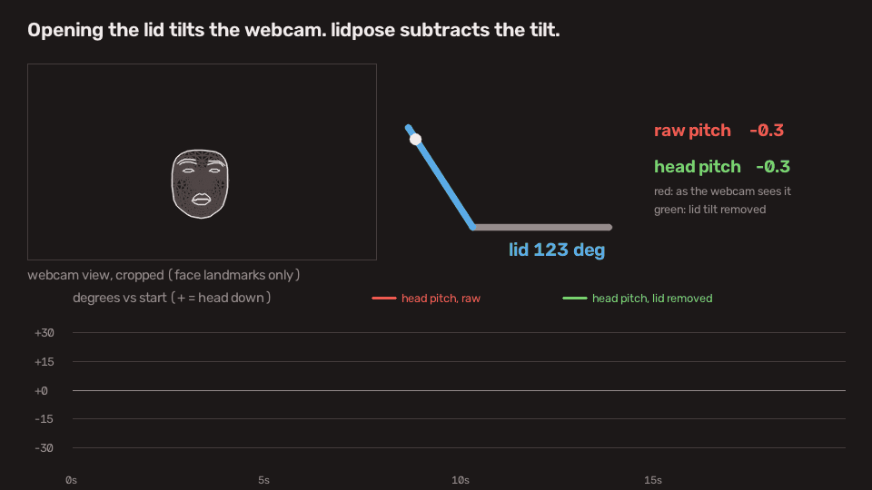

# lidtilt

A MacBook's webcam sits in the lid, so opening or closing the lid tilts the camera,
and a head pitch estimated from the webcam moves with it. lidtilt reads the lid angle
sensor and subtracts that tilt, so the head pitch it reports mostly follows your head
rather than the screen. It measures head pitch only, not neck posture, and relative to
the posture you start in (+ = head down).



Red is the head pitch the webcam sees: it follows the lid. Green has the lid tilt
removed. The nod near the end shows in both. Recorded in run 5, 3 to 23 s (the table uses
0 to 19 s of the same run); the face is drawn from landmarks only.

This is a prototype measured on one person and one MacBook. Read
[Limitations](#limitations) before trusting a number.

## How it works

1. `lid.py` reads the lid angle (whole degrees) from the Apple sensor hub over HID, the
   same way as [LidAngleSensor](https://github.com/samhenrigold/LidAngleSensor), which
   found it.
2. `calibrate.py` measures the webcam's focal length and centre from views of a
   ChArUco board shown on a phone.
3. `head.py` finds 478 face landmarks with MediaPipe, learns your face shape from the
   first 15 frames, and solves the head pose with the calibrated camera. Head pitch is
   the tilt of the face's vertical axis toward the camera.
4. Opening the lid lowers the raw pitch by about one degree per lid degree, so the lid
   change since the start is added back, one degree per lid degree.

Re-zeroing whenever the lid moves would also work if you remember to do it; lidtilt does
it continuously, including while the lid is moving. If you wear AirPods, their head
motion sensors measure pitch against gravity and are likely better; lidtilt needs no
extra hardware.

[PostureGuard](https://github.com/caic99/PostureGuard), published earlier, combines the
same lid sensor with Apple Vision's face pitch in a menu bar app that warns when you
slouch.

## What was measured

Consistency checks: one person, one MacBook Pro (Mac16,8), one room. Each row is a
segment of a recorded run with the head held still; `analysis/table.py` recomputes them
from the recordings. Degrees.

| Segment | Lid | Head pitch SD, raw | After removing the tilt | Raw pitch change per lid degree (magnitude) |
|---|---|---|---|---|
| run 4, 0 to 15 s | 83 to 133 | 13.5 | 3.2 | 0.97 |
| run 5, 0 to 19 s | 99 to 133 | 9.8 | 2.0 | 1.09 |
| run 7, 14 to 22 s, lid and laptop distance changed together | 108 to 124 | 7.4 | 1.3 | 1.06 |

- After the lid moved from 123 to 117 degrees, the still head read +5.0 (SD 0.4) instead of
  0 in run 7, 37 to 42 s. Moving the lid also moved the face to 0.89 of its distance;
  by the run 6 distance fit that explains about 3 of the 5 degrees, and the rest is
  unexplained. The correction uses exactly 1 per lid degree, while the solved pitch moved 0.97 to
  1.17 per lid degree over five runs (the table and the two Vision runs below), which
  leaves up to about 8.5 degrees over a 50 degree lid change. After a large lid change,
  re-zero by restarting `head.py`.
- Ready-made face pitch follows only part of the lid tilt. MediaPipe's own pitch followed
  0.32 to 0.45 per lid degree over runs 1 to 3. In two further runs (lid 97 to 131,
  macOS 27, `analysis/vision_slope.py`), Apple Vision's face pitch
  (`VNDetectFaceRectanglesRequest`) followed 0.24 and 0.24, and the solved pitch 1.17 and
  1.05, on the frames where both found a face; all moved the same way. That is why
  lidtilt solves the pose itself; it is one person on one MacBook.
- These are consistency checks, not accuracy: nothing was compared against a goniometer
  or an IMU. The recordings hold face landmarks, so they are not published.

## Requirements

- An Apple Silicon MacBook with a lid angle sensor, on macOS 13 or later (the oldest
  macOS the locked OpenCV wheel supports). Some models have none or report it
  differently: M1 and M2 MacBook Air and the Touch Bar M1/M2 MacBook Pro are reported not
  to work (see the issues of
  [LidAngleSensor](https://github.com/samhenrigold/LidAngleSensor)). Only one MacBook Pro
  (Mac16,8, M4 Pro) was tested here. Intel Macs are not
  supported because MediaPipe ships only arm64 wheels for macOS.
- [uv](https://docs.astral.sh/uv/). It installs Python 3.14 if needed.
- A flat desk under the laptop.

## Setup

Run these in the macOS Terminal app, not inside an IDE or another app, so the camera
permission goes to Terminal. The first time a script opens the camera, macOS asks for
permission and the script may exit; allow it in System Settings > Privacy & Security >
Camera, quit and reopen Terminal, and run it again.

```bash
uv sync
uv run python lid.py            # prints the lid angle
```

If an iPhone is nearby, Continuity Camera can take camera 0: turn it off on the iPhone
(Settings > General > AirPlay & Continuity) or set `LIDTILT_CAMERA=1`. Turn Center
Stage off in Control Center > Video Effects while measuring.

Calibrate the webcam once. Send `board.png` to a phone (AirDrop works), open it full
screen and move it around in front of the camera, near and far and tilted. A window shows
the detected corners and frames are taken automatically until 25 views:

```bash
uv run python calibrate.py      # writes calib.npz
```

It prints the reprojection RMS; well under 1 pixel is good (0.18 here).

Then run it. Sit the way you want to compare against, face the screen and hold still
while it shows "learning your face" (15 frames with a face): that posture becomes zero.
Press `q` to quit.

```bash
uv run python head.py
```

The first run downloads MediaPipe's face landmarker model (3.8 MB, the `latest` release
of it) into `models/`.
`head.py` writes `head.csv` and `head_marks.npz` (landmarks, no images); turn the
latter into a GIF with `uv run python demo/make_gif.py head_marks.npz out.gif`.

## Limitations

- Not a medical device; do not use it to diagnose or treat pain. It reports head pitch,
  not neck flexion or the craniovertebral angle, so thresholds from the ergonomics
  literature do not apply to it. The link between these angles and neck load is not
  validated.
- Values are relative to the posture held at start. If you start slouched, that is zero.
  The face shape is learned from the first 15 frames; turning or moving then skews every
  later value. Looking down with the eyes alone is not seen.
- A front webcam sees the face, not the neck. It cannot measure a forward head posture
  that does not tilt the head, and it cannot tell neck flexion from leaning the trunk.
- The laptop must sit flat and still. On a lap or a stand the base tilts and the
  correction is wrong; there is no sensor for the base.
- Moving closer to the camera raises the reading, so leaning toward the screen reads as
  head down: about +10 degrees at 0.65 of the starting distance in one run with the head
  still. A correction for it
  (`LIDTILT_DIST_GAIN=-27.5`) is off by default: it was fitted on that one run, it also
  shrinks a real lean toward the screen, and its size depends on where the face is in
  the frame.
- Moving the lid also changes the distance to the camera, so a few degrees can remain
  after a large lid change (+5 after 6 degrees in one run).
- Turning the head far to the side leaks into pitch: during large turns in run 5 the
  reading swung about 16 degrees and fell up to about 13 (toward head up) from the steady
  value after the turn. With the head turned, the one-to-one lid correction may overcorrect
  (not measured).
- Closing the lid below about 85 degrees can push the face out of view.
- Whether zero holds over long sessions has not been measured; the longest still segment
  checked is a few seconds.
- Each run overwrites `head.csv` and `head_marks.npz`; `measure.py` overwrites
  `measure.csv`.
- `calib.npz` belongs to one camera at one resolution; `head.py` and `measure.py` stop if
  the resolution differs, but another camera at the same resolution (an iPhone, an
  external webcam) is not detected and gives wrong values.

## Files

| File | Role |
|---|---|
| `lid.py` | Lid angle sensor |
| `board.py`, `board.png` | ChArUco board, camera index setting |
| `calibrate.py` | Webcam intrinsics |
| `measure.py` | Optional: camera tilt vs lid angle from the board held still (`measure.py [seconds]`, default 40, writes `measure.csv`); it prints the `LIDTILT_SLOPE` value to use (default 1) |
| `analysis/table.py` | Recomputes the table above; needs the recordings, which are not published |
| `analysis/vision_slope.py` | Optional: Vision face pitch vs solved pitch against the lid; run `uv run --extra vision python analysis/vision_slope.py` from the repository root |
| `head.py` | Head pitch, with and without the lid tilt |
| `demo/make_gif.py` | Demo GIF from a recording |

## License

MIT
